# 智眸云业财一体化 · 用户详细说明

> 适合发公众号「使用指南 / 功能详解」栏目，也可作为客户交付说明的正文底稿。  
> 面向：企业管理员、财务、业务骨干。技术事件编码仅作对照，日常以菜单名为准。

---

## 写在前面

智眸云「业财一体化」的目标很明确：

**业务单据审批通过或关键节点完成后，系统按预设凭证模板自动生成会计事件与凭证草稿（可配置是否自动过账）；财务负责核对、审核、过账、结账与报表，而不是把业务结果再录入一遍。**

本文按「你能用到什么」说明全部财务相关能力，并标出推荐操作习惯。文中流程与仓库对照表与研发文档《CRM/ERP/IFS 业财流程图》保持一致。

---

## 〇、先搞清：两条同步、七条业务线

### 1. 两条同步（不要混）

| 同步类型 | 做什么 | 结果 |
|----------|--------|------|
| **会计事件** | 业务审批/完成后推记账 | 生成会计凭证 → 过账后进科目余额、报表、往来账龄 |
| **收付款台账** | 回款/付款/开票金额回写 | 只进 IFS 收付款列表与开票金额，**不出凭证** |

日常说的「自动记账」，主要指第一条。第二条方便财务看收付款进度，但**不能当成已经出了会计凭证**。

### 2. 总览（七条线汇入财务中枢）

```text
CRM（应收价税 / 回款 / 开票）
ERP（应付 / 付款 / 采购票 / 业务单）──► 仓库入出库审批 ──► 会计事件
IFS（费用申请→报销、借款还款、存货补账、制费）
商城（支付预收→收货收入→退款分流→结算/提现）
薪资（核算计提与代扣 → 发放与缴纳）
资产（购入/退货/报废/月结折旧）
                │
                ▼
        会计事件台 → 会计凭证（草稿/审核/过账/冲销）
                │
                ▼
     科目余额 · 往来账龄 · 期末结转 · 财务报表
```

（公众号排版可将研发文档中的彩色流程图导出为长图插入此处；源文件见 `03-crm-erp-ifs-flow.md`。）

### 3. 读图/读流程时记住这些规则

- **出入库以仓库单审批为准**：采购入库、销售出库、零售/门店/换货/借还等，先转仓库入/出库单再记账；调拨单审批通过可直接推；退货若勾「无需仓库」，业务单审批即推账。  
- **同一笔货**不要同时依赖「应付/应收事项确认」和「出入库自动凭证」重复记库存（系统对同供应商同金额的入库暂估与应付确认有防重跳过）。  
- **费用**：先申请挂账，再报销付款冲挂账，不要两边都当费用记。  
- **销售退货**：同时冲成本与冲收入/应收，避免只冲库存、应收仍挂着。  
- **商城**：支付记预收，确认收货才确认收入；未收货退款冲预收，已收货退款冲收入。  
- **关账月份**：会计期间非开账时，推账失败，相关业务审批会被拦住。  
- **回款与开票是两条线**，不是必须先回款才能开票。

### 4. 仓库同步一览（财务核对用）

| 仓库动作 | 常见来源 | 记账含义（白话） |
|----------|----------|------------------|
| 入库 | 采购入库 | 货到暂估入库 |
| 入库 | 销售退货 | 退货入库 + 冲成本 + 冲收入/应收 |
| 入库 | 退料 / 完工 / 其他入 / 零售退 / 门店退 / 换货入 / 归还等 | 按业务类型入账 |
| 出库 | 销售出库 | 结转销售成本 |
| 出库 | 采购退货 | 冲应付与库存 |
| 出库 | 领料补料 / 零售 / 门店申领 / 配件申领 / 其他出 / 换货出 / 借出等 | 按业务类型出账 |
| 盘点 | 盘点完成且有盈亏 | 盘盈盘亏 |
| 调拨 | 调拨单审批 | 调入调出库存 |

成本类金额优先按物料规格「采购价/成本价」×数量，而不是用售价冒充成本。

### 5. 只展示、不同步凭证的页面

财务业务流程、凭证上传、资金分析、发票收取/统计/开具（列表看 CRM/ERP 发票）、费用分析、借还统计、奖惩单等——**便于查看与分析，不强制生成会计凭证**。真正记账仍看「业务会计事件 + 会计凭证」。

---

## 一、财务中枢：你每天会打开的菜单

| 功能 | 做什么 |
|------|--------|
| 会计期间 | 按自然月开账；可业务关账、财务关账；关闭后禁止该期间新增/过账类记账 |
| 会计凭证 | 查看自动生成或手工录入的凭证；审核、过账；支持红字冲销，列表可见冲销关系 |
| 科目余额 | 过账后查看科目余额与试算 |
| 凭证模板 | 按「业务事项」配置借贷科目与金额字段；可一键初始化默认模板（已存在的事项默认跳过，部分修正项会重建「默认-」模板） |
| 业务会计事件 | 每笔业务推账的「流水台」：成功 / 失败 / 跳过原因；失败可重试（有次数上限） |
| 财务报表 | 三大报表、损益结转等 |
| 往来账龄 | 应收/应付账龄分析（过账后才进账龄） |
| 存货核算 | 补账、计价过账入口（勿与仓库已自动记账的单据重复操作） |
| 成本域 / 生产成本 | 成本域配置；制造费用归集、完工补记等 |
| 应收账款 / 应付账款 | 对接 CRM 应收事项、ERP 应付事项的财务视角入口 |

**核心概念（建议财务同事统一口径）**

1. **业务会计事件**：业务成功后的一次记账请求，带幂等键，同一来源不会重复出成功凭证。  
2. **凭证模板**：告诉系统「这类业务借什么、贷什么、金额取哪个字段」。  
3. **过账**：凭证过账后才真正影响科目余额与账龄。  
4. **会计期间**：非「开账」状态时，自动推账会失败；关账场景下相关业务审批会被拦住并提示期间已关闭。

---

## 二、销售与客户（CRM）

### 1. 应收事项

- **何时记账**：应收事项审批通过。  
- **记什么**：确认应收账款与收入。  
- **价税**：可填税率(%)或税额；有税额优先用税额，否则按税率从价税合计拆分；都不填则税额为 0，整笔进收入（兼容旧数据）。  
- **建议**：在「确认收入」这一环把税率/税额填清楚；若此处已记销项税，后续销售开票不要再重复记同一笔税额。

### 2. 客户回款

- **何时记账**：回款审批通过。  
- **记什么**：增加银行存款（或库存现金）等，冲减应收账款。  
- **说明**：回款与开票是两条线，不是「必须先回款才能开票」。

### 3. 销售开票

- **何时记账**：发票审批通过。  
- **记什么**：以税额为主；无税额时可不生成凭证（避免与应收确认重复记收入/应收）。  
- **价税**：同样支持税率 / 税额字段。

---

## 三、采购与供应商（ERP）

### 1. 采购入库（仓库入库完成后）

- **记什么**：库存增加，应付暂估增加（货到票未到的常见处理）。  

### 2. 应付事项

- **何时记账**：应付事项审批通过。  
- **记什么**：确认存货与应付。  
- **防重**：若同一供应商、同一金额已成功做过「采购入库暂估」，应付确认可能跳过出凭证，避免库存双记（事件台可看到说明）。  
- **说明**：进项税拆分主要在「采购发票」，应付事项本身一般不单独拆税。

### 3. 供应商付款

- **何时记账**：付款审批通过。  
- **记什么**：冲减应付，减少银行存款等。

### 4. 采购发票

- **何时记账**：采购发票审批通过。  
- **记什么**：冲暂估、记进项税、转正式应付等（按模板）。  
- **价税**：支持税率 / 税额；只填一个即可。

### 5. 采购退货

- 需出库的，以仓库出库审批为准；无需出库的，退货单审批即可推账。  
- **记什么**：冲减应付与库存（按模板）。

---

## 四、仓库与存货（ERP 出入库）

原则：**多数业务单先转到仓库入/出库单，仓库审批通过后再记账**，保证账实同步。

### 入库类（示例）

| 业务来源 | 财务含义（概要） |
|----------|------------------|
| 采购入库 | 暂估入库 |
| 销售退货入库 | 冲成本 + 冲收入/应收 |
| 生产退料 / 加工入库 | 生产成本相关 |
| 其他入库、零售退货、门店退货、换货入库、归还入库等 | 按对应模板入账 |

### 出库类（示例）

| 业务来源 | 财务含义（概要） |
|----------|------------------|
| 销售出库 | 结转主营业务成本 |
| 采购退货出库 | 冲应付与库存 |
| 领料 / 补料 | 生产成本 |
| 零售出库、门店申领、配件申领、其他出库、换货出库、借出等 | 按对应模板 |

### 其他

- **盘点**：有盈亏时推盘点盈亏凭证。  
- **调拨**：调拨单审批通过后推账（调入/调出库存）。  
- **成本金额**：出库/退货等成本类金额优先取物料规格「采购价/成本价」×数量，避免用售价冒充成本。完整移动加权可后续升级。

---

## 五、费用、借款与报销（IFS）

### 推荐流程：申请 → 报销付款

1. **费用申请**审批通过：借费用，贷其他应付款（挂账）。  
2. **费用报销**审批通过：借其他应付款，贷银行存款等（**付款冲挂账，不再重复借费用**）。  

请勿跳过申请直接报销（否则挂账科目可能不平衡）；特殊「直接报销」场景请用手工凭证或后续增强能力。

### 借款 / 还款

- 借款审批：增加其他应收等，减少现金。  
- 还款审批：反向冲回。  

### 制造费用

- 费用申请/报销中费用类型或事由含「制造费用」时，可自动归集到生产成本相关事项。  
- 也可在 IFS「生产成本/制费」入口手工归集。

---

## 六、薪资人事（EHR）

| 节点 | 财务含义（概要） |
|------|------------------|
| 薪资核算生成待发放 | 实发计提；个人社保公积金代扣；单位社保公积金计提；个税代扣（金额为 0 则跳过对应事件） |
| 薪资发放 | 实发支付；社保公积金缴纳；个税缴纳（当前为发放时一并简化处理） |

科目与模板需预先初始化（如应付职工薪酬、应交个税等）。具体以贵司工资项目配置与凭证模板为准。

---

## 七、固定资产（行政资产）

| 业务 | 财务含义（概要） |
|------|------------------|
| 资产入库审批 | 固定资产增加 |
| 资产退货审批 | 冲减固定资产 |
| 资产报废 | 冲原值、累计折旧与净值损失（按卡片数据） |
| 月结折旧 | 财务流程图「固定资产月结折旧」：选账套/期间 → 预览 → 执行；批量计提并回写累计折旧 |
| 折旧补账 | 例外差额补记入口（一般走月结主路径即可） |

折旧政策（年限、残值率、开始折旧月等）在资产卡片布局中维护。

---

## 八、商城与门店资金（Shop）

商城既影响**门店资金台账**（可提现、冻结），也会推**业财事件**（总账）。个人店与企业店按租户规则入账，查询事件台时请切换到正确租户。

| 业务时点 | 门店资金（概要） | 总账（概要） |
|----------|------------------|--------------|
| 支付成功 | 一般尚未入账可提现 | 借银行存款，贷预收账款 |
| 确认收货 | 货款/佣金进入冻结（期满结算） | 预收结转主营收入；有规格采购价时结转成本（暂不自动拆销项税） |
| 未收货退款 | 通常不扣已入账余额 | 冲预收 |
| 已收货后退款 | 按本单已入账/冻结扣回 | 冲收入（并可冲成本） |
| 结算到期 | 冻结转可提现 | 结算 / 佣金相关事项 |
| 提现打款成功 | 减少可提现 | 冲其他应付款，贷银行存款 |
| 保养套餐双方确认 | — | 往来确认事项 |

资金流水里，退款类流水的业务 ID 可能是售后单号，列表会尽量带出订单号，便于点开订单详情。

---

## 九、关账与合规

1. **开账期间**才允许该月正常新增凭证与自动推账。  
2. **业务关账 / 财务关账**后：  
   - 凭证侧禁止该期间记账类操作；  
   - 会推业财事件的业务审批会被拒绝（提示会计期间已关闭），避免关账后继续改账。  
3. **冲销**：已过账凭证走红字冲销；列表可查看「冲销 / 已被冲销」关系；冲销凭证不可再次冲销。  
4. **幂等**：同一业务来源重复推送不会重复生成成功凭证；以事件台为准。

---

## 十、推荐上线与日常操作清单

### 首次上线（管理员 + 财务）

1. 执行财务相关数据库脚本（含总账表、发票/应收价税字段等，以交付清单为准）。  
2. 初始化会计科目、会计期间开账。  
3. 凭证模板页点击「初始化默认模板」，再按贵司科目微调。  
4. 抽测：一笔回款、一笔付款、一笔采购入库、一笔销售出库、一笔商城支付+收货。  
5. 在「业务会计事件」与「会计凭证」交叉核对金额与科目。

### 日常（业务）

- 按原流程提单据、审批即可，无需额外「点记账」。  
- 关账月份不要再强行审批会推账的单据。  

### 日常（财务）

- 看事件台是否失败（模板缺科目、期间关闭等）。  
- 审核/过账凭证；核对余额与账龄。  
- 期末损益结转与关账。  
- 月结固定资产折旧。  

### 费用习惯

- 先费用申请，再报销付款，避免费用双记或挂账不平。  

### 价税习惯

- 应收确认、销售开票、采购发票：税率和税额填一个即可。  
- 应收已记销项税的，开票侧避免重复计税。  

---

## 十一、默认分录在说什么（培训对照，模板可改）

过账后才进账龄。下表为默认模板含义，贵司可在「凭证模板」中调整科目。

| 业务 | 默认分录（白话） | 是否进账龄 |
|------|------------------|------------|
| 应收确认 | 借应收；贷收入（不含税）+ 销项税 | 应收 |
| 销售开票 | 有税才记销项税；不重复确认收入 | 否（税） |
| 客户回款 | 借现金；贷应收 | 冲应收 |
| 应付确认 | 借库存；贷应付 | 应付 |
| 采购入库暂估 | 借库存；贷应付暂估 | 应付 |
| 采购发票 | 冲暂估、进项税、正式应付 | 影响应付 |
| 供应商付款 | 借应付；贷现金 | 冲应付 |
| 销售出库 | 借成本；贷库存 | 否 |
| 销售退货 | 借库存贷成本 + 借收入贷应收 | 冲应收 |
| 费用申请 | 借费用；贷其他应付款 | 否 |
| 费用报销 | 借其他应付款；贷现金（冲挂账） | 否 |
| 商城支付 | 借现金；贷预收 | 否 |
| 商城收货 | 借预收贷收入；有成本再借成本贷库存 | 否 |
| 商城退款 | 未确认收入冲预收；已确认冲收入 | 否 |
| 薪资计提/发放 | 费用/应付职工薪酬 ↔ 现金等 | 否 |
| 固定资产购入/折旧/报废 | 固定资产、累计折旧、费用等 | 否 |

完整编码级对照见研发文档 `03-crm-erp-ifs-flow.md`「默认分录」表。

---

## 十二、功能全景对照（方便对内培训）

| 模块 | 能力摘要 |
|------|----------|
| 财务中枢 | 期间、凭证、模板、事件、余额、报表、账龄、存货补账、成本域、制费 |
| CRM | 应收（价税）、回款、开票（价税）；回款/开票另写收付款台账 |
| ERP 往来 | 应付、付款、采购发票（价税）；付款/采购票另写收付款台账 |
| ERP 仓存 | 采购/销售/其他/生产/零售/门店/换货/借还/盘点/调拨等出入库推账 |
| IFS 费用借款 | 申请挂账、报销付款、借款还款、制费 |
| EHR | 薪资计提发放、社保公积金、个税 |
| 资产 | 购入退货报废、月结折旧 |
| 商城 | 预收、确认收入与成本、退款分流、结算佣金提现、保养往来 |

---

## 十三、常见问题

**Q：为什么事件成功了但没有凭证？**  
A：可能是「跳过出凭证」的设计（例如开票无税额、或应付与入库防重跳过）。请看事件台说明文字。

**Q：为什么审批失败提示会计期间已关闭？**  
A：凭证日期所在月份已关账。请财务重开期间，或把业务做到开账月份。

**Q：销售退货凭证为什么又有成本又有收入？**  
A：政策要求退货同时冲成本与冲收入/应收，避免只冲库存、应收仍挂着。

**Q：商城为什么支付时不记收入？**  
A：支付先进预收；确认收货再确认收入，更符合「交付后确认收入」的习惯，也便于未发货退款只冲预收。

**Q：费用报销为什么不再借费用？**  
A：费用已在申请时计入；报销只是付钱冲掉挂账，避免费用记两次。

---

## 结语

业财一体不是让财务「少做事」，而是让财务从**重复录入**转向**规则、核对、结账与分析**。

业务侧把单据做对、审批走完；财务侧把模板与期间管好——两边各做擅长的事，账才能又快又稳。

如需演示环境逐步点菜或行业模板定制，请联系实施 / 售后同学。

**— 智眸云 · 业财一体化用户说明**

---

## 附录：彩色总流程图（技术源）

以下与 `03-crm-erp-ifs-flow.md` 同源。**公众号无法直接渲染 Mermaid**，请用支持 Mermaid 的工具（如 Typora、VS Code、在线 mermaid.live）导出 PNG/JPG 后插入正文「〇、总览」处。

```mermaid
graph TB
  classDef ifs fill:#e6f4ff,stroke:#1677ff,color:#003a8c
  classDef biz fill:#f6ffed,stroke:#52c41a,color:#135200
  classDef hub fill:#fff7e6,stroke:#d48806,color:#613400
  classDef wms fill:#eef8f0,stroke:#389e0d,color:#135200
  classDef shop fill:#f9f0ff,stroke:#722ed1,color:#391085
  classDef ehr fill:#fff1f0,stroke:#cf1322,color:#820014
  classDef adm fill:#fffbe6,stroke:#d4b106,color:#614700

  subgraph CRM[1 CRM]
    C1["客户、合同"]
    H02["应收事项 可拆销项税"]
    H01a["客户回款"]
    C3["销售开票 可拆销项税"]
    CRME["出口 会计事件"]
    CRMP["出口 收付款台账"]
    C1 --> H02
    C1 --> C3
    H02 --> H01a
    H02 --> CRME
    C3 --> CRME
    H01a --> CRME
    H01a --> CRMP
    C3 --> CRMP
  end

  subgraph ERP[2 ERP业务单]
    E1["供应商、合同"]
    H03["应付事项"]
    H01b["供应商付款"]
    E5["采购发票 可拆进项税"]
    E4["采购入库单"]
    E8["销售出库单"]
    E9["销售退货 冲收入+成本"]
    E10["其他/零售/门店/换货/借还"]
    E13["调拨单"]
    ERPE["出口 会计事件"]
    E1 --> H03
    H03 --> H01b
    E1 --> E5
    H03 --> ERPE
    H01b --> ERPE
    E5 --> ERPE
    E9 --> ERPE
    E13 --> ERPE
    E4 --> WIN
    E8 --> WOUT
    E10 --> WIN
    E10 --> WOUT
  end

  subgraph WMS[3 仓库]
    WIN["仓库入库单"]
    WOUT["仓库出库单"]
    WMSE["出口 会计事件"]
    WIN --> WMSE
    WOUT --> WMSE
  end

  subgraph IFSB[4 IFS]
    G01["费用申请→报销"]
    G03["借款→还款"]
    J02["存货补账/制费"]
    IFSE["出口 会计事件"]
    G01 --> IFSE
    G03 --> IFSE
    J02 --> IFSE
  end

  subgraph SHOP[5 商城]
    S00["支付预收→收货收入→退款"]
    S01["结算/佣金/提现"]
    SHOPE["出口 会计事件"]
    S00 --> SHOPE
    S01 --> SHOPE
  end

  subgraph EHR[6 薪资]
    W1["核算→发放"]
    EHRE["出口 会计事件"]
    W1 --> EHRE
  end

  subgraph ADM[7 资产]
    A1["购入/退货/报废/月结折旧"]
    ADME["出口 会计事件"]
    A1 --> ADME
  end

  F07["会计事件"]
  F03["凭证→余额/账龄/报表"]
  CRME --> F07
  ERPE --> F07
  WMSE --> F07
  IFSE --> F07
  SHOPE --> F07
  EHRE --> F07
  ADME --> F07
  F07 --> F03

  class C1,C3,H01a,E1,E4,E5,E8,E9,E10,E13,H01b biz
  class WIN,WOUT wms
  class S00,S01 shop
  class W1 ehr
  class A1 adm
  class H02,H03,G01,G03,J02,F03 ifs
  class CRME,CRMP,ERPE,WMSE,IFSE,SHOPE,EHRE,ADME,F07 hub
```



---

### 公众号发布提示（编辑用，可不发）

- 建议拆成三篇：①总览与中枢 ②销购仓与费用 ③商城薪资资产 + FAQ  
- 务必插入「总流程图」长图（从附录 Mermaid 导出）  
- 标题备选：  
  - 《智眸云业财一体：从应收开票到商城提现，财务能管什么？》  
  - 《给财务和业务看的业财说明书（完整版）》  
- 文中表格在公众号可改为「加粗小标题 + 条目」，阅读更友好  
